# MTG Vec2Search

Search Magic: The Gathering cards by describing them in plain English
("cheap green elves that ramp"), with filters for color identity, card type,
mana value, format, price and set. Or paste a Commander deck (a Moxfield or
Archidekt link, or a decklist) to see which cards similar decks play that
yours doesn't, browse every commander's decks and what's trending, and see
which cards' decks win more in cEDH tournaments, and which cards' prices are rising
or falling, with every printing's price history since 2020. Dark mode by
default. It's a static site: all the heavy lifting happens at build time, and a
search only downloads the small pieces of the index it needs (~200 KB the first
time, a few KB after that).

**Live site:** https://grahamirwin.github.io/MTG_Vec2Search/

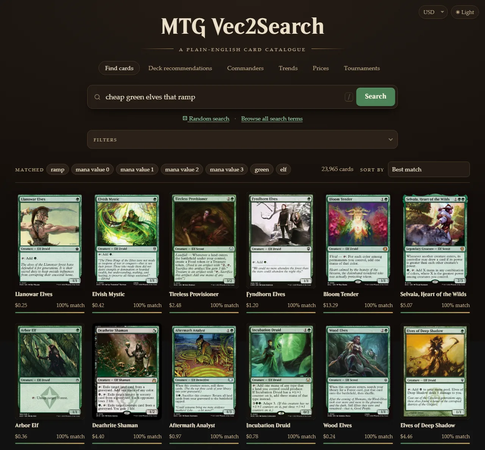

## How it works

<picture>
  <source media="(prefers-color-scheme: dark)" srcset="docs/images/pipeline-dark.svg">
  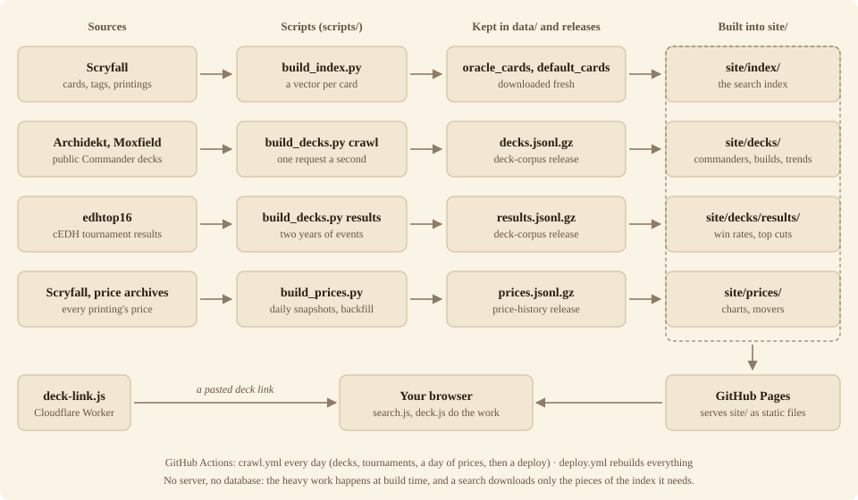
</picture>

1. `build_index.py` downloads Scryfall's `oracle_cards`, `oracle_tags` and
   `default_cards` (every printing, for the cheapest price) bulk data and turns
   each card into a sparse binary vector over a term space:
   - colors, types, keywords, subtypes and mana value
   - the tokens it makes ("create two 1/1 white Spirit creature tokens with
     flying" → makes white / Spirit / creature / flying tokens)
   - **oracle tags** from the community [Scryfall Tagger](https://tagger.scryfall.com)
     project, which describe what cards *do*: `tutor-instant`, `hate-nonbasic-land`,
     `removal-artifact`, `token-doubler`, … (~3,000 tags, with their aliases)

   Keywords, subtypes and tags come from the data itself, so new mechanics are
   picked up automatically. The output, `site/index/`, is split so a search
   only fetches what it uses:
   - `meta.json`: the terms, card counts and tag aliases (for parsing queries)
   - `columns.json`: per-card colors, types (and the one it is listed under: front face, lands first), mana value, formats and price (for filters)
   - `t/<term>.json`: which cards have each term (only the query's terms are fetched)
   - `c/<chunk>.json`: names and image ids, 256 cards each; cards are in
     popularity order, so top results come from the first few chunks
   - `names.json`, `released.json`: names and first-release dates, only fetched
     for card-name searches and the name/date sorts
   - `aliases.json`: other names cards are printed under (Universes Beyond's: Glittering
     Caves of Aglarond is Gemstone Caverns; Scryfall's `flavor_name` and English
     `printed_name`). Searching one finds the card, though its words would read as a search
     ("cave"), and decklists and the Prices lookup know them too
   - `s/<n>.json`: the cards printed in each set (`meta.json` lists the sets,
     newest first), only fetched to filter by set
2. In the browser, `site/search.js` maps the query to the same terms:
   - a tag matches when all its words (or an alias's) are in the query, after
     folding plurals, verb forms ("drawing" → draw) and a little slang
     ("punishes" → hate, "makes" → create, "steal" → theft, "non-basic" →
     nonbasic, "can't cast" → silence, "win the game" → win condition)
   - related tags form one group where the most specific gets full credit
     ("instant tutors": `tutor-instant` 100%, `tutor` 50%)
   - words that a tag uses describe its target, not the card ("**artifact** hate"
     isn't looking for artifacts)
   - after "makes"/"creates", words describe the token

   Cards are ranked by IDF-weighted query coverage, so rare features count for
   more than common ones. Ties go to the more popular card, by EDHREC rank.
   "under $5", "less than 3 euros" or "budget" (under US$1) in a query sets
   the price limit; prices are each card's cheapest printing.

   For “cheap green elves that ramp”, Elf is the rarest term (694 cards), so it counts for the most; a
   card scores the share of the query's weight it covers:

   <picture>
     <source media="(prefers-color-scheme: dark)" srcset="docs/images/search-dark.svg">
     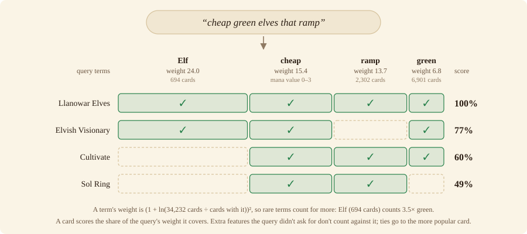
   </picture>

   Prices are shown in the visitor's currency: guessed from their time zone
   (then browser language), changeable in the top corner, and converted from
   Scryfall's USD prices with [Frankfurter](https://frankfurter.dev).

   **Sort by** reorders results by best match, popularity, release date (first
   printing), price or mana value. Sorted by anything but match, only cards at
   least 75% as good a match as the best one are kept.

   **Browse all search terms** on the page lists every term with its card count.

   Hovering a card shows its name; clicking it opens its details. A
   double-faced card has a button over the top right of its art that turns it
   over (`index/c/` marks the cards with a back face, whose image is the same
   Scryfall id under `back/`).
3. **Deck recommendations** compares a Commander deck with public decks from
   [Archidekt](https://archidekt.com) and [Moxfield](https://moxfield.com):
   - `build_decks.py crawl` downloads decks through Archidekt's API (one request a
     second) into the deck corpus (see [The deck corpus](#the-deck-corpus)): each deck's
     commanders and cards. It takes the recently updated decks first, then takes turns
     through every commander, least recently crawled first (ones it has no decks for too).
     `--site moxfield` does the same on Moxfield, whose search finds a commander
     by its own card id (looked up by name) and stops at 10,000 decks, and whose
     decks list printings (turned into oracle ids with Scryfall's
     `default_cards`). A deck's id says where it's from: Archidekt's are
     numbers, Moxfield's strings.
   - Cards banned in Commander now (Scryfall's legality, read on every build) are left out of
     what the decks play, so nothing suggests them (older decks still have Jeweled Lotus).
   - `build_decks.py build` writes `site/decks/`: one file per commander (or
     partner pair) with its newest 10,000 decks. Each deck is stored as positions
     in that commander's list of cards, most played first, gap-encoded like the
     card index, which comes to about 100 bytes per deck over the wire.
     It also counts the decks made each month over all of the commander's decks, not just the
     10,000 kept (`months`).
     `index.json` lists every commander with its "signature" cards, the ones
     its decks play far more often than other decks do.
   - In the browser (`site/deck.js`), decks are compared by cosine similarity
     over the cards they play, each weighted by how rare it is among that
     commander's decks (IDF), so Sol Ring and Command Tower count for almost
     nothing. The decks most like yours (those at least 30% as alike as the
     closest, 10 to 100 of them) vote on **cards to add**, by similarity, minus
     half of how often any deck with that commander plays the card, so the list is what decks like yours play more than usual rather than
     staples. **Cards to cut** are yours that similar decks rarely play, shown
     with their images like the cards to add.

     <picture>
       <source media="(prefers-color-scheme: dark)" srcset="docs/images/shared-cards-dark.svg">
       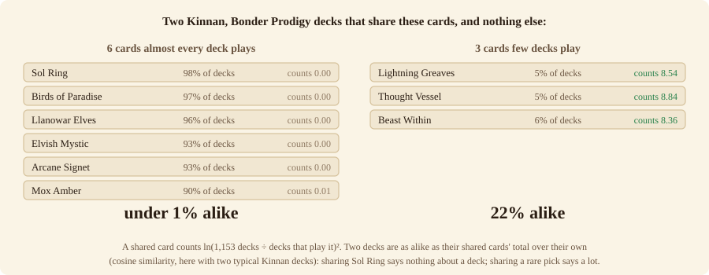
     </picture>

     <picture>
       <source media="(prefers-color-scheme: dark)" srcset="docs/images/card-weights-dark.svg">
       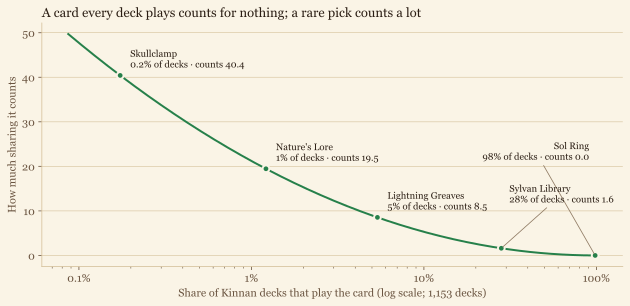
     </picture>

     <picture>
       <source media="(prefers-color-scheme: dark)" srcset="docs/images/recommend-dark.svg">
       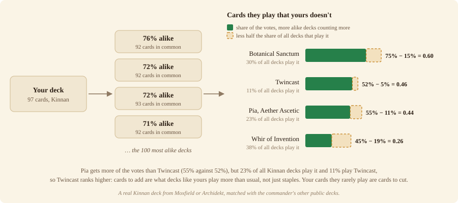
     </picture>

   - A commander with tournament results can be matched with its cEDH tournament lists instead
     (buttons beside "compared with": `decks=tournament`, or `decks=topcut` for only those that
     made the top cut, each with `MIN_AVERAGE_DECKS` decks or more): `tournamentPool()` turns
     `results/lists/<key>.json` into a shard, each list named for its record, so cards to add and
     cut and the similar decks (each with a Compare link) come from those lists.
   - A pasted Moxfield or Archidekt link is read by `worker/deck-link.js`, a
     small Cloudflare Worker: neither site's API can be called from another
     site's page (CORS). It fetches just that one deck and returns it as a
     plain decklist, each line naming its printing as the sites' exports do
     (`1 Sol Ring (CMM) 410 *F*`). A link also goes in the address bar (`?deck=<link>`), so
     results can be shared.
   - A commander with too few decks is compared with the commander whose
     signature cards the deck plays the most of. That same match powers "decks
     like yours with other commanders".
   - **Packages** shows the packages of the commander's decks that the deck runs (all their cards, or
     at least half: a dotted ring), linked as on the commander page; a package's own graph shows just
     the cards of it, and of those decks with it add most, that the deck runs. The
     packages are found the first time the section is opened, which takes a moment for a commander
     with thousands of decks.

     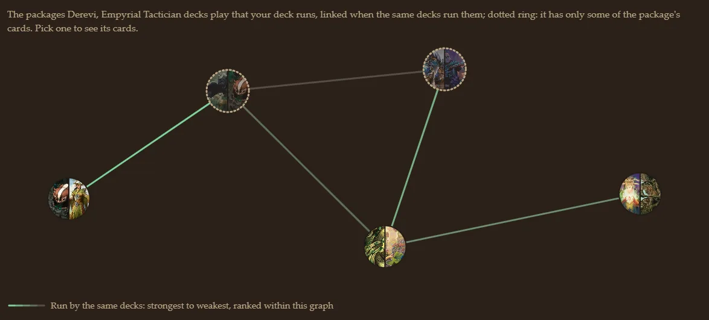

   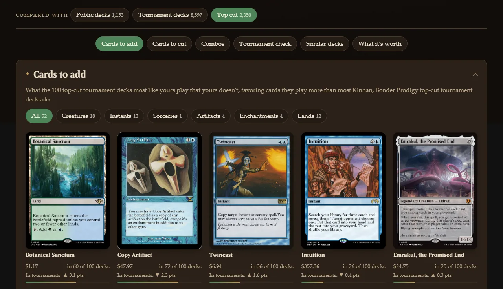

   Card-overlap similarity was checked against a "functional" similarity over
   the search terms above (tags, keywords, types) by hiding 10 cards of real
   decks and recommending them back. Card overlap alone did best (about 39% of
   hidden cards in the top 20, against 31% for "most played with this
   commander"), so that's all the browser computes.
   **Pages are laid out the same way** (`showSections()` in `site/app.js`): what a page is about at
   the top, then what narrows it (a commander's build and bracket), then one row of buttons for its
   sections, shown one at a time (`view=` in the address bar), each with a line on what it is and
   the details under "How these are worked out" at the bottom (`pageSections()`): Prices, a
   commander's page, Trends (commanders, cards), Tournaments (commanders, pilots, cards) and a
   deck's recommendations (against a list, cards to add and cut, combos, packages, tournament check, similar
   decks, what it's worth). A section with nothing to show has no button.
   **Price tags read the same everywhere** (`priceTag()`): the price now, its change (green up, red
   down), and under it the printing (set, foil) and what it cost then, saying when ("$80.96 30 days
   ago", "before the reprint"); a change in how often a card is played names its period too.
4. **Commanders** (`?commanders`) lists every commander with decks, which
   Trends' filters narrow down; partners show both cards, overlapped, the one
   behind coming forward when pointed at. Each one's
   page (`?commander=<file name>`) shows its signature cards, every card its
   decks play, an average deck and the decklists themselves. The average deck
   takes as many spells and nonbasic lands as the decks play on average (the
   most played of each), then basic lands to make 100, every deck counting the same. It's of the
   public decks of the build and bracket picked, or (`avg=tournament`) every cEDH tournament list
   of the last two years wherever it placed, or (`avg=topcut`) only those that made their event's
   top cut, from `results/lists/` (each needs `MIN_AVERAGE_DECKS` decks). It copies or
   downloads as a plain list, or opens in Deck recommendations against yours ("Compare your
   deck with it": `?deck&from=avg.<file name>&cards=<its card numbers in base 36>&of=<build>`, a
   link like a tournament list's, the cards in the average deck and not yours, and in yours and
   not it). Its decks are split into **builds** in the
   browser: spherical k-means over the same IDF-weighted cards, leaving out
   lands (they split decks by budget, not plan), one build per 50 decks to
   start, dropping builds under 8% of the decks and merging ones too alike.
   A build is named for the Scryfall Tagger tag whose cards it plays the most
   more of than the commander's other decks ("Poison mechanics", "+1/+1
   counters matter"); `build_decks.py build` stores the tags of each
   commander's commonly played cards in its file for this, for commanders with
   enough decks to split. Picking a build narrows everything on the page to it,
   including its **trends**: the cards its decks made in the last 7, 30 or 90
   days play more often than its decks overall, and the new cards (first
   printed in the last 120 days) they've picked up. The page also shows what a
   typical deck costs, its typical bracket, and what its decks are **known
   for**: the Tagger tags whose cards they play far more of than decks in
   general do (`buildTags`' scoring, against every deck instead of the
   commander's own), so Teysa is known for aristocrats even though all her
   builds are. Each links to Trends, filtered to commanders known for it.

   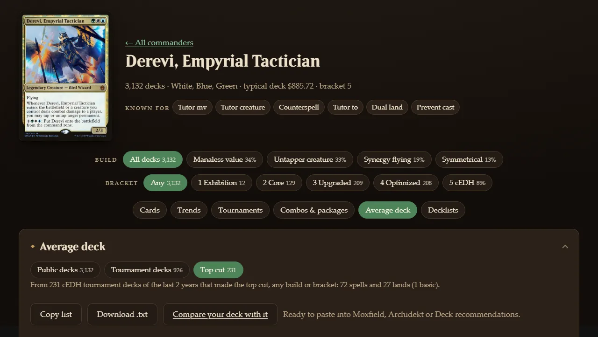

   Derevi's 3,132 public decks fall into four builds, each a region of decks that play alike cards:

   <picture>
     <source media="(prefers-color-scheme: dark)" srcset="docs/images/builds-dark.svg">
     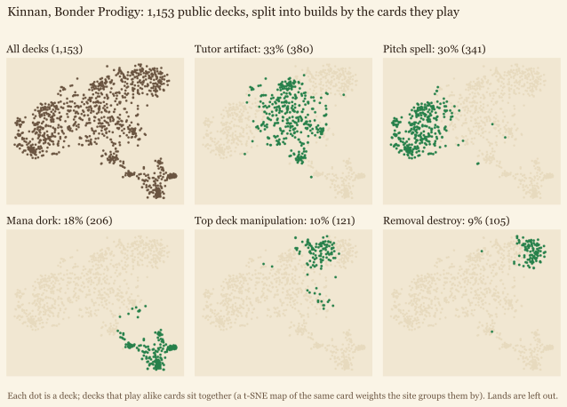
   </picture>

   Decks can also be narrowed to a **bracket**, the one each deck's builder
   gave it (most Moxfield decks have one, few Archidekt ones), alone or with a
   build. The build and bracket are in the address bar
   (`?commander=…&build=…&bracket=5`), so a view is a link to share.
   `build_decks.py crawl --bracket 5` fetches just one bracket's decks.

   A card's details link to its commander page, if it has one, and to its
   page in commander decks (`?card=<number>`): the commanders whose decks
   play it most often, grouped by what those decks are known for.

   Opened from a commander's page, a card's details also show it **with that
   commander**: its play rate by month among the commander's decks (and, with
   tournament results, its decks' win rate by month against all the
   commander's decks; months with few decks are faded), **Played more with**
   (cards the decks playing it play more often than the commander's decks as a
   whole, e.g. "42% → 48% of decks (595 decks)"), **Wins more with** (cards
   whose tournament decks with both win more than those with only this card,
   over the page's results period, clear differences only, e.g. "26% → 38% win
   rate (412 decks play both, 300 only Jeska's Will)"), and a **synergy graph**:
   the card in the middle and around it the cards played with it clearly more than chance (a
   correlation of 0.2 or more between being in a deck, the strongest 12; 8 on a phone). Every line is
   such a correlation, the same width, ranked strongest to weakest and coloured by its fifth of the
   ranking, dark green to pale grey, so a graph's ties are easy to tell apart; dotted lines are pairs
   rarely played together (one or the other: two packages, two color builds). Between the cards around it, only
   pairs that stand out from the rest show (the decks playing a card mostly share one build, so most
   of its partners go together a little). With tournament results, dashed lines join a "Won" node to
   the cards whose decks win clearly more (green) or less (red, used for nothing else) with them. Picking a card in the
   lists or the graph opens it. The page's **Trends** section charts the decks
   made per month, over all of the commander's decks.

   

   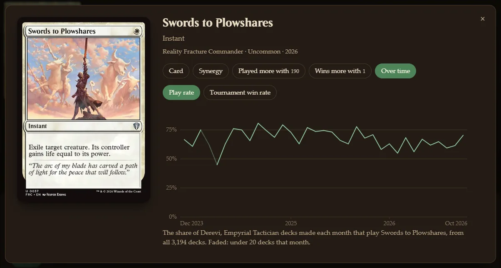

   Its **Combos & packages** section lists the Commander Spellbook combos its decks play and its
   **packages**: cards its decks play together far more often than chance (`findPackages`), compared
   among decks of the same build, as tuned and with as many Game Changers (`packageGroups`), so cards
   don't go together just for being in the same kind of deck. Packages show as a list ("31% of these
   decks play all of them (412)") or, with 3 or more, as a **graph** (Graph | List; the graph first):
   one node per package run by enough of the build's decks (`packageMap`, the 12 most run; 8 on a
   phone), named for its two strongest cards (half of each one's art on it; the name shows, whole, when
   it's pointed at, rather than cut short under it), every line the correlation between decks running two
   packages, ranked and coloured like the synergy graph's, dotted for either/or packages (different
   builds), and with tournament results a Won node joined to the packages whose decks clearly win
   more (green) or less (red) than those with none of it. Picking a package swaps in its own graph
   (`packageGraph`, "All packages › Displacer Kitten + Teferi" to go back): its cards around it,
   linked by how strongly they pair, and around them the cards decks running it add most (played far
   more by them than by the other decks; 4 on a phone), each tied to the Won node if decks with the
   package and it win clearly more or less than those with the package alone. Picking a card opens it.

   

   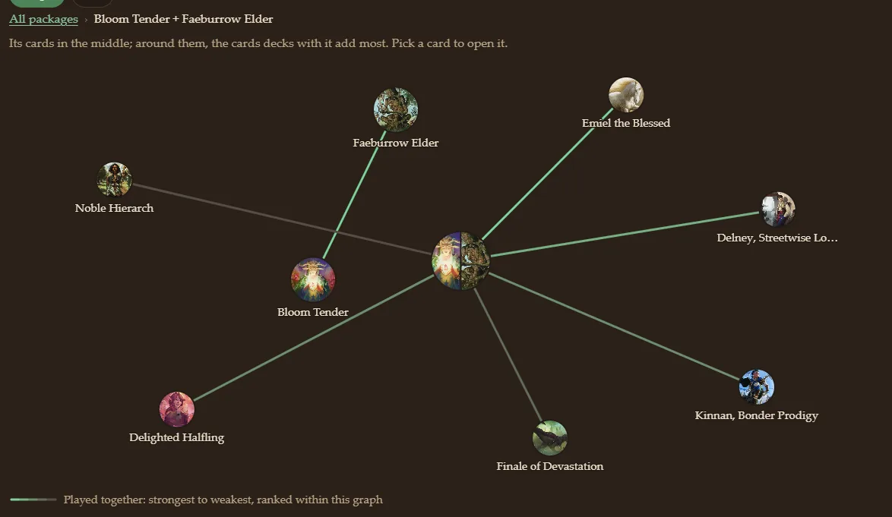

   All three graphs (a card's, the package map, a package's) are laid out the same way
   (`layoutGraph`): nodes push each other apart and lines pull the cards they join together (the
   stronger, the closer; either/ors apart), and each node is pulled toward the middle the more lines it
   has, so the most linked sit in the middle and the least at the edges. A node a line runs under is
   moved off it, and the layout is tried from a few starting points until none is; the rare line it
   still can't clear is drawn bending around the node. It's spread to the shape of the room it's drawn
   in (wide on a computer, tall on a phone) and is the same every time for the same data.

   **Tournament results**, for commanders with cEDH decklists on
   [TopDeck.gg](https://topdeck.gg) (where most cEDH tournaments are run), over the last 3, 6, 12 or
   24 months:
   - `build_decks.py results` keeps `results.jsonl.gz`: every EDH tournament of 16 players or more
     with a decklist in it (the build uses the last two years'; older ones stay in the file), each entry's commander, record, standing,
     decklist link, cards and pilot, from [TopDeck.gg's API](https://topdeck.gg/docs/tournaments-v2)
     (`fetch_results()`). It asks for a week of tournaments at a time, 6 seconds apart, from 3 days
     before the newest it has (results and decklists come in after an event starts) to today, and
     saves each week as it arrives, so it can stop and go on; `--days N` fetches the last N days
     again. It's additive: nothing it has is dropped, and a tournament is only replaced by a copy
     with as many decklists or more. Entries without a decklist are skipped (they rarely say which commander either).
   - It needs a TopDeck.gg API key (free, from its developer portal), which the API's terms ask
     to credit with a visible link (the site's footer and tournament pages have one): in
     `data/topdeck_key.txt` or the `TOPDECK_API_KEY` environment variable locally, and as the
     `TOPDECK_API_KEY` repository secret for the daily crawl (`gh secret set TOPDECK_API_KEY`).
   - The first two years came from [edhtop16](https://edhtop16.com), which gets them from TopDeck
     too, until it stopped answering outside queries in October 2026. Pilots keep edhtop16's
     numbers (each entry also has the player's TopDeck profile); a player new since gets the next
     number, so tournaments should be fetched in one place at a time: the daily crawl.
   - `build_decks.py build` writes `results/<file name>.json` per commander:
     how many decks, games, wins and top cuts its decks had in each period,
     the same for the decks that play each card and for each pilot, and its
     newest top 4 finishes with who played them. Cards are matched by name.
   - **Pilots**: who played its decks, and how it does without the 2 who won
     the most: a commander can look strong because of one or two players.
   - **Points per game** count 5 for a win and 1 for a draw; with draws, the
     average deck scores a little over 1.2.
   - Each card's decks are measured against the commander's other decks, not
     against every deck, so a card in strong commanders' decks doesn't look
     good for it. The measure is games won rather than top cuts (a deck plays
     5 to 8 games, but makes a cut once). To keep small samples from shouting,
     both win rates are pulled toward the commander's by 100 games' worth
     before they're compared, and a card's difference only counts as **wins
     more** or **wins less** when it's two standard errors or more, counting
     a deck's games as half as many independent ones (they share a pilot and
     a list). New cards are listed either way, faded when there's too little
     to go on. Decks with a card winning more doesn't prove the card wins
     more: good players pick up new cards first.


   <picture>
     <source media="(prefers-color-scheme: dark)" srcset="docs/images/shrinkage-dark.svg">
     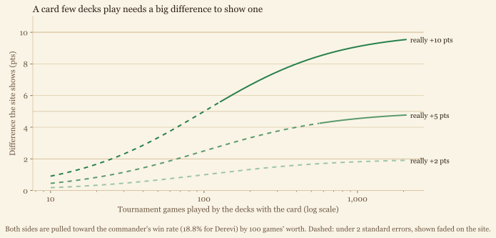
   </picture>

   - The headline numbers compare the commander's decks with every deck in
     the period: with draws, an average deck wins about a fifth of its games,
     not a quarter.
   - **Test a card or a package**: its example is a random niche card, one
     5 to 25% of the commander's tournament decks play. Pick one or more cards (in the address bar
     as `package=`) to compare the decks that play all of them with those that
     play none, over the chosen period, pulled toward the commander's win rate
     the same way (`packageResults`). It needs each tournament deck's cards, so
     `results/lists/<file name>.json` holds them one by one, fetched only when
     a card is picked, with each one's tournament month (`months`).
   - **Made the cut**: among the decks in events with a top cut, the cards whose share of decks
     differs most between those that made it and those that missed it (`cutGroups()` and
     `playedDifferently()`): what they play more, and less, the biggest gap first, 6 at a time
     (**Show more** for the next), among cards at least 15% of either plays, over the period picked. Each card has a dot for each on a 0–100% track and its
     two shares; pointing at, tapping or tabbing to a dot pops up its share and number of decks (dots
     too close to point at apart share one). With a few hundred decks a small gap can be chance, so
     a difference under two standard errors is faded. It reads `results/lists/` too, so it's
     only counting once that's loaded.

   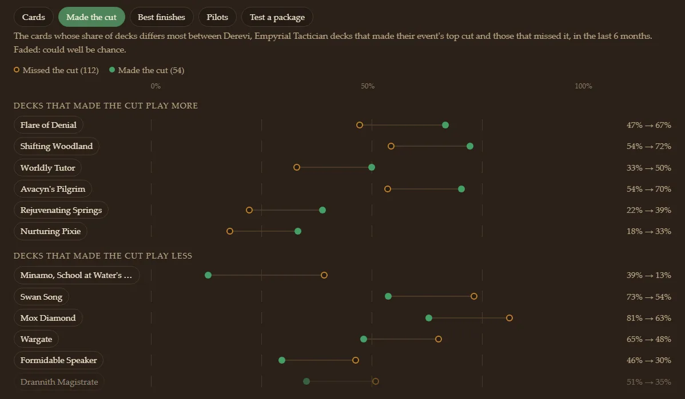

   - Picking **bracket 5** notes each card's tournament result on the page's
     card tiles. **Deck recommendations** gets a **tournament check** when the
     deck's commander has results (your cards whose decks win less, cards
     whose decks win more that you don't play, and **made the cut, or missed it**: your cards whose
     share of decks differs most between those that made the cut and those that missed it, and the
     cards the ones that made it play more that yours doesn't), and notes on cards to add and
     cut. A card's details say how its decks did, with that commander and
     across commanders.
5. **Trends** (`?trends`) shows rising and most popular commanders and cards,
   and new cards, over decks made in the last 7, 30 or 90 days or all time.
   Filters (color identity, where a commander must be exactly the colors
   picked; typical deck price and bracket; a strategy; single commanders or
   partners; a minimum of decks) narrow it to the commanders that pass; the cards are then those commanders' decks'. Rising compares a share
   of the window's decks with the share of all decks, relative to it, so a
   commander or card going from 1% to 4% beats one going from 60% to 66%.
   - The crawler keeps each deck's creation date (and fills it in for decks it
     already had from the search listings it reads anyway). Archidekt decks
     crawled before dates were kept get the date of the last dated deck before
     them, as Archidekt numbers decks as they're made. Each window starts on a
     date, and every deck falls in or out by when it was made.
   - `trends.json` holds each commander's decks made per window, price,
     bracket and themes, plus exact card counts over all decks, for the
     unfiltered page. Each commander's cards that at least 15% of its decks
     play in some window are split two ways, so a page fetches only what it
     needs: `trend-cards/<color identity>.json` for a filtered page (a color
     filter keeps one of the 32), and `card-commanders/<block>.json` for a
     card's page (the commanders playing each of 16 cards). The Commanders and
     Tournaments tabs fetch `trends.json` only once their filters are used.
6. **Tournaments** (`?tournaments`) ranks every commander with tournament
   decks by decks, points per game, share of games won or share of decks making the top cut,
   each against every deck's, over the last 3, 6, 12 or 24 months. Its cards are
   compared across commanders without letting commanders count: `pooled()` in
   `build_decks.py` takes, for each commander with 3 or more decks with a card
   and without it, the difference in games won between them, and averages
   those differences weighted by how much each can be trusted, then pulls the
   result toward none by 100 games' worth (`results/index.json`).
   The commanders can be narrowed with Trends' filters, less the ones that
   don't fit tournament decks (bracket: they're all cEDH; deck price: a
   casual deck's; minimum decks: the table has its own), and the period,
   sort and filters are in the address bar. Above it, **the last 30 days**: the
   commander with the most points per game (20 decks or more), the breakout
   (the most decks for its share of the 90 days before) and the one whose
   points per game rose most (15 decks or more on each side), three different
   ones (`highlights()`).
   - **Pilots** ranks the players with 5 or more tournament decks in two years
     (`results/ranking.json`) by match points, points per game, games won or
     top cuts. The search at the top of the tab finds pilots by name, with the
     commanders they play (`results/pilots.json`: each pilot's decks of each
     commander). A commander's page lists all its pilots in the period it shows. A pilot's page (`?tournaments&pilot=<number>`)
     is their profile: their main commander, rank by match points, best finish
     (the highest place for the field's size), record against every deck's,
     what they play and how they do on it, and
     every deck they played, from `results/pilots/<block>.json` (64 players a
     file, by their number: see `fetch_results()`).
   - **Favorite cards** (`pilot_cards()`): the cards in more of a pilot's decks
     than if their decks were like other decks of the same commanders, from 2
     of their decks or more, with their games won with each card and without.
   - **List over time**, for each commander a pilot played 2 or more times:
     their games won in their earlier events against their later ones; the
     cards in some of their lists but not all, with their games won with each
     and without (the clearest differences first: a difference counts for more
     with more games on both sides); and event by event, what they added and
     cut since the list before. All from `results/lists/`, in the browser.
   - **Compare** on any tournament deck (a pilot's, or a commander's best
     finishes) compares your deck with it in Deck recommendations
     (`?deck&from=<commander file name>.<number>&pilot=<number>`): the cards
     in their list and not yours, and in yours and not theirs, each ranked by
     how the commander's tournament decks with it did against those without
     (as on its page), so the first are what to add and what to cut. The list
     comes from the cards kept for it in `results/lists/`, since almost every
     decklist is on TopDeck, which Deck recommendations can't read; it can
     also get recommendations for that list itself (without saving it as yours).

   A card can stand for a style of deck: within Kinnan, the creature-heavy
   lists win more than the ones with Force of Will and Mana Vault. So these
   say what winning decks play, not that a card wins on its own, and the page
   says so.


   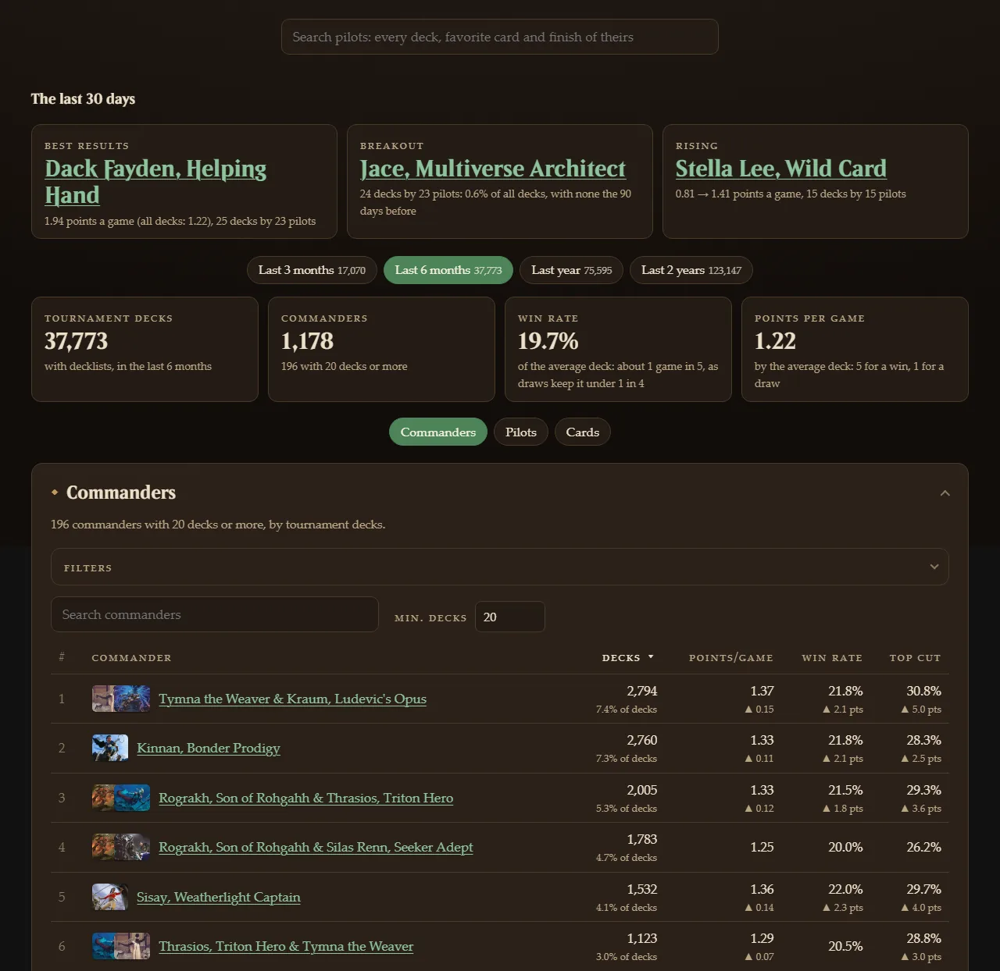

7. **Prices** (`?prices`) shows the printings whose prices rose and fell the most over 7, 30 or
   90 days or a year, and the reserve list, from the price history below. The finish (nonfoil, or
   foil and etched), a price ("$5 and up": at least that on both days, so a 10-cent card doesn't
   top the list going to $5) and **Filters** like the card search's (color identity, mana value,
   format, and the printing's set) go in the address bar (`?prices&w=90&finish=foil&price=20&c=G`).
   The page shows one section at a time, picked under the card lookup (`view=` in the address bar):
   Rising & falling, Spec buys, Buyouts, Tournament spikes, Reprints, Reserve list and Watchlist,
   each with only the controls that apply to it, a line on what it is, and the details under "How
   these are worked out".
   The prices to pick are round amounts of the visitor's currency (C$1, C$5, C$20, C$100), each
   the nearest 1, 2 or 5 times a power of ten to US$1, $5, $20 and $100. Foil printings' tiles
   shimmer like the foil in a card's details, which open on the foil price.


   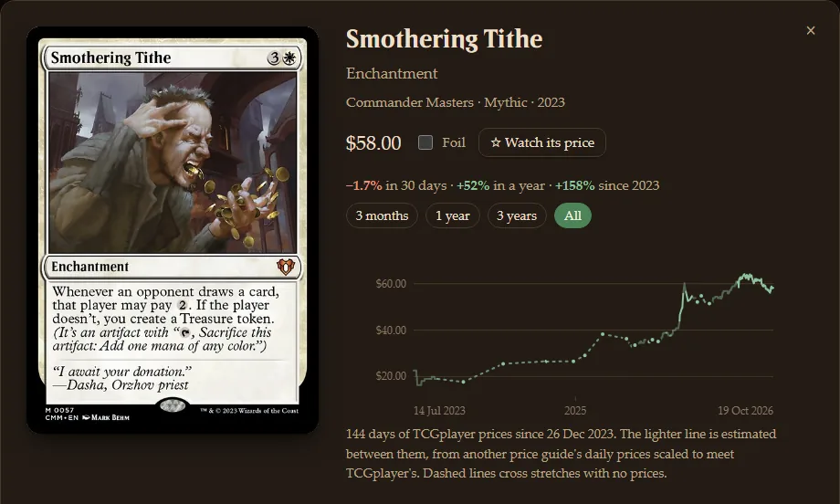

   - `build_prices.py site` writes `site/prices/`. A printing's price there is the median of its
     last 3 days within a week, so one odd day doesn't make it rise or fall. `movers-<days>.json`
     keeps the 150 biggest rises and falls of each finish and band of prices (from 50 cents to
     $200 and up, 9 bands), and the size of change each band's list stops at. The page cuts a list
     where the first of its bands runs out, so a list for any amount is never missing a printing
     (about 300 KB a period).
   - **Reserve list**: one of every card on it (its cheapest nonfoil printing) over time, and each
     printing, rising, falling or most expensive.
   - A card's details chart its printing's price (nonfoil or foil, as picked) over 3 months, a
     year, 3 years or all of it, from `prices/p/<first 3 characters of its Scryfall id>.json`
     (4,096 files: the id is the key, so a card's chart reads one file of about 25 KB, never the
     rest). Between our days, a lighter line is estimated (below), a day at a time back to 2010
     or the printing's release; lines across stretches with no prices at all are dashed.
   - Prices aren't split by condition, so a card that rarely sells (Tabernacle) can swing with
     which copies sold; the page says so.
   - **Look up a card** at the top finds cards by name (most played first, names starting with
     what's typed before the rest) and opens one's details, with its price history.
   - Over the chart, how much its price changed in 30 days, a year, and since its first price
     (when that's 2 years back or more).
   - **Reserve list** has a button for every printing or just the tournament-legal ones (not
     Collectors' Edition's, 30th Anniversary's, gold-bordered or oversized: Scryfall's
     `memorabilia` sets), each with its own total over time (`rl=legal` in the address bar).
   - **Spec buys and buyouts**: cards new Commander decks play far more than usual (1.5 times their
     share of all decks, in 0.3% of the last 30 days' decks or more) whose price barely moved (under
     10%), and cards whose price rose 30% or more while new decks play them no more than usual
     (a buyout, speculation, or another format), from Trends' data and `prices/cards.json`.
   - **Tournament spikes**: cards in 1.5 times their year's share of cEDH tournament decks over
     the last 90 days (30 decks or more), with their 90-day price change.
   - **Reprinted lately**: cards with a new paper printing out in the last 120 days, and how the
     older printing that was cheapest 45 days before it came out has moved since
     (`prices/reprints.json`), the biggest falls first.
   - **Watchlist**: ☆ in a card's details watches that printing and finish (kept in the browser);
     the Prices tab lists them with their 30-day and 1-year changes, and copies a link to the list
     (`?prices&watch=<card>.<printing>.<0 nonfoil, 1 foil>,…`) that opens it for someone else.
   - **Cheaper cards that do the same thing**, in a card's details, for cards at $5 or more: the
     same main type, within its color identity, half its price or less, with most of its Scryfall
     Tagger tags (each weighted by how rare it is), from `prices/alts/<n>.json`.
   - **Deck recommendations** also say what a deck is worth: each card at the printing its line
     names (`1 Sol Ring (CMM) 400 *F*`: set, collector number, `*F*` foil or `*E*` etched, as
     Moxfield and Archidekt export them, or a pasted link), else at its cheapest, now, up or down
     how much over 7 days, 30 days, 90 days or a year as picked (`w=`, over the cards priced
     then), and every card by price (the default) or the ones rising or falling most in that time (`order=`). The
     printings' prices are in `prices/sets/set-<code>.json` (one file per set, so a deck fetches
     only its sets'), the cheapest in `prices/cards.json` (each card's cheapest price now, 7, 30, 90 and
     365 days before, by card number).

## Updating card data

GitHub Actions rebuilds the index and redeploys every Monday. To update right
away (e.g. on a set's release day), open **Actions → Build and deploy → Run workflow**.

The deck corpus is too big for git, so it lives on the `deck-corpus` release.
**Actions → Crawl decks** adds to it every day (the day's tournament results,
then about two and a half hours on each site), then redeploys the site so Trends
stays current. To grow it faster, crawl locally:

```
gh release download deck-corpus --dir data --pattern 'decks-[0-9]*' --pattern decks-cards.json --pattern crawl_state.json --pattern results.jsonl.gz
python scripts/build_decks.py crawl --hours 24      # stop with Ctrl+C and resume any time
python scripts/build_index.py                       # Moxfield needs default_cards.jsonl.gz first
python scripts/build_decks.py crawl --site moxfield --hours 24
```

When a crawl stops (Ctrl+C, or its hours run out) it uploads the corpus, crawl
state and tournament results to the release (and starts a deploy, so the site
has them), after first merging in any decks and tournaments the release has
that it doesn't (the daily crawl's, say), so an upload never loses any.
`--no-upload` skips that; `python scripts/build_decks.py share` does it on its own. The
daily crawl uploads the same way, since a local crawl may have uploaded while it
ran: replacing the release's files outright would lose what arrived meanwhile.

To fill in commanders the corpus barely has, top up the most played ones (by
EDHREC rank) to a number of decks each, several at a time. Run one crawl at a
time: they share `decks-new.jsonl.gz`, and Archidekt answers 429 (everything pauses)
past about 3 requests a second. Moxfield sometimes lets 8 a second through, but often
answers 429 at that rate too, so 2 or 3 gets more decks over a long run. For a long local
crawl, pause the daily one so they don't crawl (and fetch tournaments) side by side:
`gh workflow disable crawl.yml`, then `gh workflow enable crawl.yml` once it has uploaded.

```
python scripts/build_decks.py crawl --top 3500 --per-commander 5 --rate 2    # enough for every commander first
python scripts/build_decks.py crawl --top 3500 --per-commander 20 --rate 2   # then more
python scripts/build_decks.py crawl --only "Atraxa, Praetors' Voice" --per-commander 3000 --rate 2   # one commander's newest 3,000
python scripts/build_decks.py crawl --only "Derevi, Empyrial Tactician" --bracket 5 --per-commander 1000   # just its bracket 5 decks
```

### The deck corpus

The corpus is split by commander into 64 files, `decks-00.jsonl.gz` to `decks-63.jsonl.gz`
(every deck of a commander or partner pair is in the same one), so no file nears GitHub's 2 GB
limit for a release asset, and a build holds one at a time (a full build peaks at 3.5 GB of
memory, from 11 GB with one file). A deck lists its cards as numbers in `decks-cards.json`, a
list of oracle ids that's only added to, so a card's number never changes: 640,000 decks take
101 MB, from 746 MB as oracle ids.

A crawl doesn't load the decks, just what it needs to know of each (its id, last update and
commanders). It appends what it fetches to `decks-new.jsonl.gz`, which `share` and `build` fold
into the 64 files: of each deck's copies, the one updated last wins. The release's copy of the
corpus is folded in the same way before an upload. Card numbers that two crawls gave new cards
differently are matched up then too.

A deck found gone (deleted, made private) keeps its record with `"removed"`: the date it was
found gone. Builds leave it out, and a newer version brings it back. `build_decks.py delta FILE`
folds in a file of decks (as the crawl saves them) and notes such as `{"id": …, "removed":
"2026-10-30"}`, which is how a feed of changes (say, a site's daily export) would come in.

The corpus from before it was split, `decks.jsonl.gz`, is folded in the same way when it's there,
then kept as `decks-backup.jsonl.gz` (on the release too).

## Price history

`build_prices.py` keeps `prices.jsonl.gz` on the `price-history` release: the price of every paper
printing on every day it has, nonfoil, foil and etched each on its own, in US dollars (TCGplayer)
and euros (Cardmarket). The Prices tab and card details read it (see **Prices** above).

- **Crawl decks** adds the day's prices from Scryfall's `default_cards` every day
  (`build_prices.py snapshot`), dated by when Scryfall made the file.
- `python scripts/build_prices.py backfill` adds every older day it can find: the Wayback Machine's copies of
  Scryfall's bulk files (a day each, 2023 on; older ones are cut off or have no prices), of
  MTGJSON's `AllPrices` (90 days each, from late 2021 and early 2023), its `cardPrices.csv` and
  MTGJSON 4's `AllPrintings` (a day each, back to November 2020), then MTGJSON's current 90 days.
  Run it again any time: it only fetches files it hasn't imported (or found cut off).
  `--no-upload` keeps it local.
  It also reads two Hugging Face datasets: MTGJSON's 90 days as of September 2026 (every day from
  June 22, 2026), and Scryfall's `default_cards` uploaded now and then from December 2025 to March
  2026 (a day each, the day it was uploaded). Those are Parquet files, so they need `pyarrow`
  (`pip install pyarrow`); nothing else does.
- Where Scryfall and MTGJSON both have a week, their prices match (the same median, 97% of US
  prices within 10%).
- **Estimates between our days**: `python scripts/build_prices.py goldfish --hours 24` fetches another
  price guide's daily history (back to 2010) of every printing at 50 cents or more (`--least 1`:
  every printing with a price) and the whole reserve list, the reserve list first, then the
  priciest, one request every 2 seconds, into
  `goldfish.jsonl` (a line per printing and finish as it arrives: stop and run it again any time;
  `python scripts/build_prices.py goldfish --stop` stops a crawl running elsewhere, or Ctrl+C it).
  `--workers 3` runs 3 side by side, each taking every third printing into its own
  `goldfish.<n>.jsonl`, merged in when they stop; each still waits 2 seconds between requests.
  It finds each printing by the guide's set codes (`scripts/goldfish_sets.json`, from its set pages, by
  name or else by code) and, for a name printed more than once in a set, the card's page. Sets
  it has no page of (The List, promo sets, Fallout) and printings not found that way are looked
  for on the card's own page (by a set of it there, ours, or its search), which lists every
  printing in every set: by set, collector number, finish and variant (a promo set's stamped
  or prerelease printing is a variant in the set it's from, or in the guide's own promo sets). A
  history whose latest price isn't near ours (within a factor of 2, or 5 when the printing is
  sure) is taken for another printing and skipped. Its prices are its own measure, 0 to 20% off
  TCGplayer's depending on the year, so they're never stored as ours: `site` scales them to meet
  ours on each of our days (the ratio a straight line from one of our days to the next) and uses
  them only between, marked as estimates. The site gets every day's estimate, kept where it moved
  1% or more (`daily()`: flat in between, invisible at a chart's size), which keeps all of them
  to about 25 KB per file gzipped. `site` works them out with numpy (`pip install numpy`).
- Only changes are stored: each printing's prices are lists of `[day, cents]`, a point only where
  the price changed since the day before (null when it stopped having one). The first line lists
  the days and where each came from. A day with none of a price at all (MTGJSON has a few days
  without Cardmarket's, or TCGplayer's) keeps every printing's price from the day before. A day
  already in it is never replaced, and both commands merge with the release's copy before
  uploading, like the deck corpus.

## The deck link Worker

Deploy it once to a free Cloudflare account, then put the URL it prints in
`DECK_LINK` in `site/app.js`:

```
cd worker
npx wrangler login
npx wrangler deploy
```

It only answers the site (and localhost, for testing), and only fetches Moxfield and
Archidekt deck pages, one per request, cached for 10 minutes.

## Running locally

Python 3.11+ (standard library only):

```
python scripts/build_index.py              # download data + build site/index/ (~1 min)
gh release download deck-corpus --dir data --pattern 'decks-[0-9]*' --pattern decks-cards.json
gh release download deck-corpus --dir data --pattern results.jsonl.gz   # tournament results (optional)
python scripts/build_decks.py build        # site/decks/, for Find similar decks
gh release download price-history --dir data --pattern prices.jsonl.gz
python scripts/build_prices.py site        # site/prices/, for Prices and price charts
python scripts/serve.py                    # http://localhost:8000, changes show on a plain refresh
```

The scripts run from anywhere: they read and write their data in `data/` (not in git) and build
into `site/`.

Tests: `python tests/test_build_index.py`, `python tests/test_build_decks.py`, `python tests/test_build_prices.py`
and `node --test` (Node 24).

## Files

- `scripts/build_index.py`: downloads data from Scryfall, vectorizes the cards, writes the index
- `scripts/build_decks.py`: crawls Archidekt and Moxfield decks and TopDeck.gg's tournament results, writes the per-commander deck files
- `scripts/build_prices.py`: keeps the price history of every printing (daily from Scryfall, backfilled from archives)
- `scripts/serve.py`: serves `site/` locally
- `tests/`: the scripts' and the site's self-checks
- `data/`: Scryfall downloads, the deck corpus, tournament results and price history (local, gitignored;
  the corpora live on the `deck-corpus` and `price-history` releases)
- `docs/`: background reading (vector space search), and the README's images (`docs/images/`):
  `python docs/figures/make_figures.py` redraws the diagrams and charts from the locally built site
  (with the site's own code, so the numbers match it; needs matplotlib and scikit-learn), and
  `python docs/figures/screenshots.py` retakes the screenshots while `scripts/serve.py` runs (Playwright)
- `site/index.html`, `site/app.js`: the page
- `site/search.js`: query parsing and ranking
- `site/deck.js`: decklist parsing, similar decks, recommendations, builds, trends and tournament results
- `worker/deck-link.js`: Cloudflare Worker that turns a deck link into a decklist
- `site/currency.js`: currency detection, exchange rate and price formatting
- `.github/workflows/deploy.yml`: weekly rebuild and GitHub Pages deploy
- `.github/workflows/crawl.yml`: daily price snapshot, deck crawl and tournament results, then a deploy

Card data and images come from [Scryfall](https://scryfall.com), decklists from
[Archidekt](https://archidekt.com) and [Moxfield](https://moxfield.com), tournament data provided by
[TopDeck.gg](https://topdeck.gg) (its first two years through [edhtop16](https://edhtop16.com)). MTG Vec2Search is
unofficial Fan Content permitted under the Fan Content Policy. Not
approved/endorsed by Wizards. Portions of the materials used are property of
Wizards of the Coast. ©Wizards of the Coast LLC.
